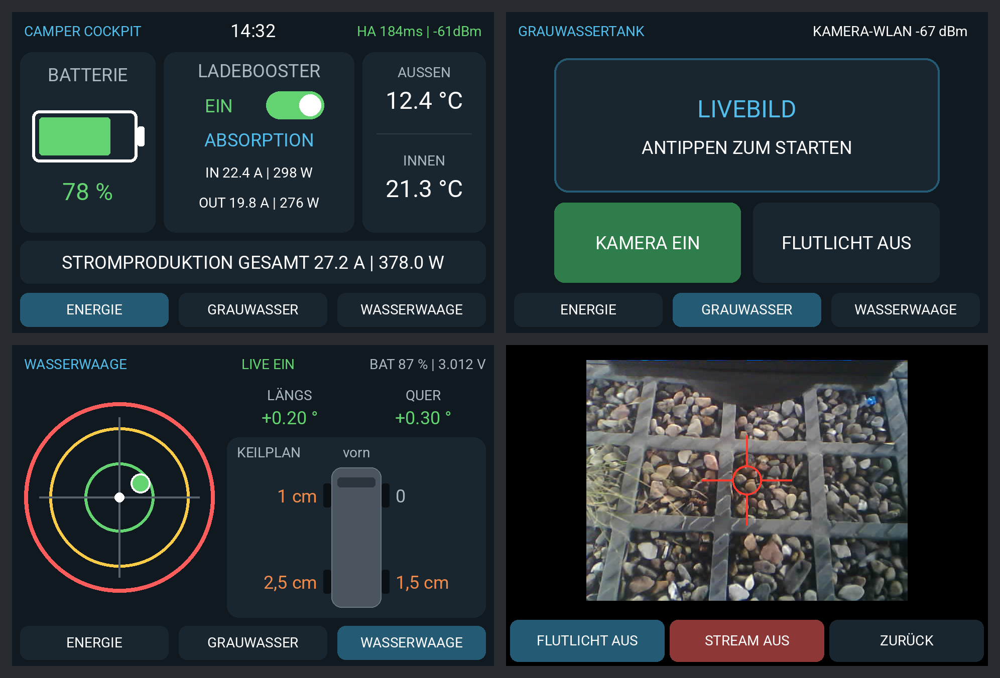

# ESPHome Camper Cockpit

**English** | [Deutsch](README.md)

A touch display for the cockpit of a motorhome or camper van: energy, grey water tank camera and a spirit level with a wedge plan at a glance. The display runs on [ESPHome](https://esphome.io) and gets its data from Home Assistant.

*Preview of the four pages (rendered from the configuration, sample values).*

> **Note:** The on-screen labels are in German (e.g. *AUSSEN* = outside, *INNEN* = inside, *WASSERWAAGE* = spirit level, *KEILPLAN* = wedge plan). The comments in the example files are also in German; every setting is explained in English below and in [docs/home-assistant.en.md](docs/home-assistant.en.md).

## Features

- **Energy:** battery state of charge, switch the charge booster, DC-DC charger (state, input/output), total production, outside and inside temperature
- **Grey water:** switch camera and floodlight, live image with one tap
- **Spirit level:** bubble level with adjustable tolerance rings, pitch and roll, wedge plan with the wedge height for each wheel
- **Camera:** MJPEG live image with crosshair, straight from Home Assistant
- Unavailable values are shown as “--” instead of a wrong number
- Diagnostic line with HA response time and Wi-Fi signal

## Hardware

- **Guition JC3248W535** (ESP32-S3, 16 MB flash, 8 MB PSRAM, 3.5″ 480×320, capacitive touch)

Pins and display driver are set up for exactly this board. Other boards need changes in `cockpit-display.yaml`.

## Requirements

- Home Assistant with the entities you want to show
- ESPHome **2026.9.0 or newer** (tested with 2026.9.1)
- A long-lived access token of an **administrator** in Home Assistant

Which kind of entity each setting needs is described in [docs/home-assistant.en.md](docs/home-assistant.en.md).

## Installation

1. **Create your device file:** Copy [`example/cockpit.yaml`](example/cockpit.yaml) into your ESPHome folder (`/config/esphome/` with the Home Assistant add-on). You can choose any file name.
2. **Add your secrets:** Add the entries from [`example/secrets.yaml.example`](example/secrets.yaml.example) to your `secrets.yaml`. The token is entered **with** “Bearer ” in front of it.
3. **Fill in your values:** Enter your HA address, your entities and your vehicle’s dimensions (track width, wheelbase) in the device file.
4. **First flash via USB:** Connect the board via USB-C and choose “Install” → “Plug into this computer” in ESPHome. After that, updates go over Wi-Fi.
5. **Add it to Home Assistant:** The display shows up under Settings → Devices & services as a new ESPHome device. Add it and enter the API key from your `secrets.yaml`. Without this step the spirit level stays empty.

The device file loads the actual logic as a package straight from this repository. You don’t need to copy or edit `cockpit-display.yaml`.

## Settings

Optional, in the device file under `substitutions`:

| Setting | Default | Meaning |
|---|---|---|
| `display_title` | `CAMPER COCKPIT` | Title of the energy page |
| `level_live_switch` | `false` | `true` if the tilt sensor needs a live switch (then also set `entity_level_live`) |
| `timezone` | `Europe/Berlin` | Time zone of the clock |
| `track_cm` | `180` | Track width in cm |
| `wheelbase_cm` | `404` | Wheelbase in cm |
| `wedge_step_cm` | `0.5` | Rounding of the wedge heights |
| `level_green_deg` | `0.5` | Green ring of the bubble level in degrees |
| `level_yellow_deg` | `1.5` | Yellow ring in degrees |
| `level_max_deg` | `3.0` | Edge of the bubble level in degrees |

## Updates

With `ref: main` the device file always points to the latest version. ESPHome checks for changes once a day, and the next **Install** puts the new version on the display. What changed is listed in the [CHANGELOG](CHANGELOG.md) (German) and under [Releases](https://github.com/joeetti/esphome-camper-cockpit/releases).

**Problems after an update?** Replace `main` with the last release that worked, e.g. `ref: v1.0.0`, and install again. Your display stays on that version until you switch back to `main`.

With **Watch → Custom → Releases** on GitHub you get a notification for every new release.

## Troubleshooting

- **Top right shows “HA OFFLINE” or “HA JSON FEHLER” (JSON error):** check the HA address and the token. The token must start with “Bearer ” and belong to an administrator.
- **Single values stay “--”:** the entity doesn’t exist or is unavailable. Check the spelling in HA’s developer tools.
- **Warning “could not resolve … is undefined” while compiling:** an `entity_…` entry is missing in the device file.
- **Spirit level shows “API GETRENNT” (API disconnected):** the display is not (or no longer) added to Home Assistant, see installation step 5.
- **Feature not available** (e.g. no charge booster): enter an entity that doesn’t exist, such as `switch.not_available`. That part of the display stays empty.

## Credits

- [online_video](https://github.com/albert-canfield/esphome-online-video) by albert-canfield for the camera image (MIT)
- [ESPHome](https://esphome.io) and [LVGL](https://lvgl.io)
- Font: Roboto (Apache 2.0), downloaded from Google Fonts during the build

## License

[MIT](LICENSE). Use at your own risk, especially when switching charging equipment in the vehicle.
