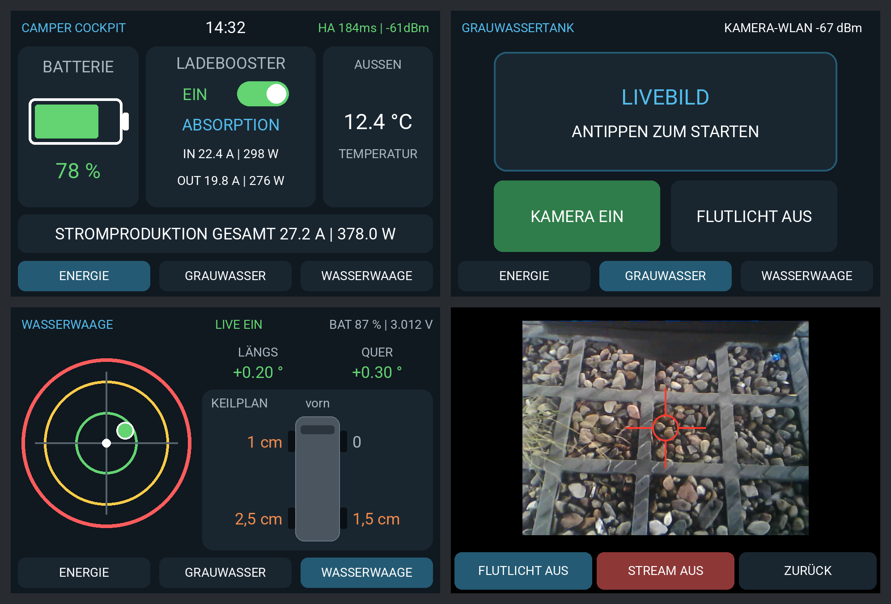

# ESPHome Camper Cockpit

Ein Touch-Display fürs Cockpit von Wohnmobil oder Camper: Energie, Grauwassertank-Kamera und eine Wasserwaage mit Keilplan auf einen Blick. Das Display läuft mit [ESPHome](https://esphome.io) und holt seine Daten aus Home Assistant.

*Vorschau der vier Seiten (aus der Konfiguration gerendert, Beispielwerte).*

## Funktionen

- **Energie:** Batterie-Ladezustand, Ladebooster schalten, DC-DC-Wandler (Zustand, Ein-/Ausgang), Gesamtproduktion, Außentemperatur
- **Grauwasser:** Kamera und Flutlicht schalten, Livebild per Fingertipp
- **Wasserwaage:** Libelle mit einstellbaren Toleranzringen, Längs- und Querneigung, Keilplan mit Keilhöhe je Rad
- **Kamera:** MJPEG-Livebild mit Zielkreuz, direkt aus Home Assistant
- Nicht verfügbare Werte erscheinen als „--“ statt als falsche Zahl
- Diagnosezeile mit HA-Antwortzeit und WLAN-Signal

## Hardware

- **Guition JC3248W535** (ESP32-S3, 16 MB Flash, 8 MB PSRAM, 3,5″ 480×320, kapazitiver Touch)

Pins und Display-Treiber sind auf genau dieses Board abgestimmt. Andere Boards brauchen Anpassungen in `cockpit-display.yaml`.

## Voraussetzungen

- Home Assistant mit den Entitäten, die du anzeigen möchtest
- ESPHome **2026.9.0 oder neuer** (getestet mit 2026.9.1)
- Ein langlebiges Zugriffstoken eines **Administrators** in Home Assistant

Welche Entitäten welche Art haben müssen, steht in [docs/home-assistant.md](docs/home-assistant.md).

## Installation

1. **Gerätedatei anlegen:** Kopiere [`example/cockpit.yaml`](example/cockpit.yaml) in deinen ESPHome-Ordner (beim Home-Assistant-Add-on `/config/esphome/`). Den Dateinamen kannst du frei wählen.
2. **Secrets eintragen:** Ergänze deine `secrets.yaml` um die Einträge aus [`example/secrets.yaml.example`](example/secrets.yaml.example). Der Token wird **mit** „Bearer “ davor eingetragen.
3. **Werte anpassen:** Trage in der Gerätedatei deine HA-Adresse, deine Entitäten und die Maße deines Fahrzeugs (Spurbreite, Radstand) ein.
4. **Erstes Flashen per USB:** Das Board per USB-C anschließen und in ESPHome „Install“ → „Plug into this computer“ wählen. Danach gehen Updates über WLAN.
5. **In Home Assistant hinzufügen:** Das Display erscheint unter Einstellungen → Geräte & Dienste als neues ESPHome-Gerät. Hinzufügen und den API-Schlüssel aus deiner `secrets.yaml` angeben. Ohne diesen Schritt bleibt die Wasserwaage leer.

Die Gerätedatei lädt die eigentliche Logik als Paket direkt aus diesem Repository. Du musst `cockpit-display.yaml` nicht kopieren und nicht bearbeiten.

## Einstellungen

Optional in der Gerätedatei unter `substitutions`:

| Wert | Standard | Bedeutung |
|---|---|---|
| `display_title` | `CAMPER COCKPIT` | Überschrift der Energie-Seite |
| `timezone` | `Europe/Berlin` | Zeitzone der Uhr |
| `track_cm` | `180` | Spurbreite in cm |
| `wheelbase_cm` | `404` | Radstand in cm |
| `wedge_step_cm` | `0.5` | Rundung der Keilhöhen |
| `level_green_deg` | `0.5` | Grüner Ring der Libelle in Grad |
| `level_yellow_deg` | `1.5` | Gelber Ring in Grad |
| `level_max_deg` | `3.0` | Rand der Libelle in Grad |

## Updates

Die Gerätedatei zeigt mit `ref: v1.0.0` auf eine feste Version. Für ein Update die Versionsnummer auf das neue Release setzen (siehe [CHANGELOG](CHANGELOG.md)) und neu installieren. So ändert sich nichts an deinem Display, ohne dass du es willst.

## Fehlersuche

- **Oben rechts „HA OFFLINE“ oder „HA JSON FEHLER“:** HA-Adresse oder Token prüfen. Der Token muss mit „Bearer “ beginnen und zu einem Administrator gehören.
- **Einzelne Werte bleiben „--“:** Die Entität gibt es nicht oder sie ist nicht verfügbar. Schreibweise in den Entwicklerwerkzeugen von HA prüfen.
- **Warnung „could not resolve … is undefined“ beim Kompilieren:** In der Gerätedatei fehlt ein `entity_…`-Eintrag.
- **Wasserwaage zeigt „API GETRENNT“:** Das Display ist nicht (mehr) in Home Assistant eingebunden, siehe Installation Schritt 5.
- **Funktion nicht vorhanden** (z. B. kein Ladebooster): Eine nicht existierende Entität eintragen, etwa `switch.nicht_vorhanden`. Die Anzeige bleibt dann leer.

## Danksagung

- [online_video](https://github.com/albert-canfield/esphome-online-video) von albert-canfield für das Kamerabild (MIT)
- [ESPHome](https://esphome.io) und [LVGL](https://lvgl.io)
- Schrift: Roboto (Apache 2.0), wird beim Build von Google Fonts geladen

## Lizenz

[MIT](LICENSE). Nutzung auf eigene Verantwortung, insbesondere beim Schalten von Ladetechnik im Fahrzeug.
